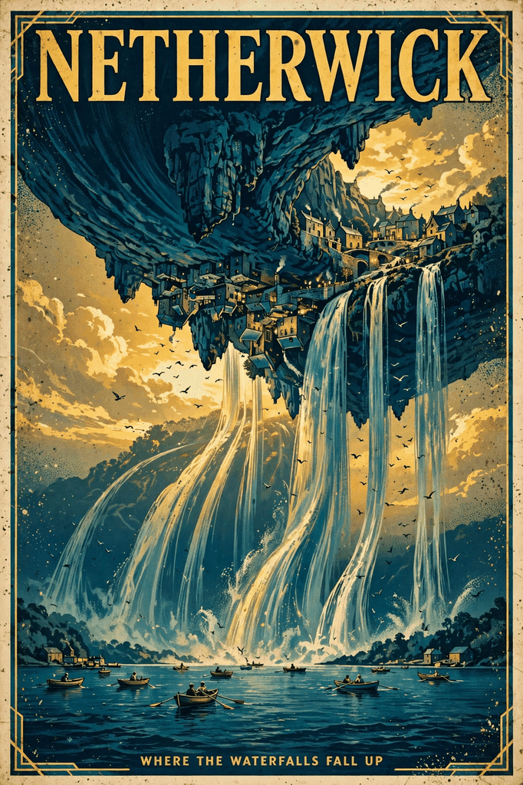

# NETHERWICK — The Poster for a Place That Isn't There

A make.fun entry for [The Poster for a Place That Isn't There](https://make.fun/bounty/the-poster-for-a-place-that-i-2-20261121-0539): a program that writes one travel-poster image to `/output/entry.png`.

**Bounty terms:** $50 pot, 20 paid places (1st $18, 2nd $6, 3rd $4, 4th $3, 5th–7th $2, 8th–20th $1), entry fee $0, entries close 2026-11-21T08:39:00Z (16:39 Asia/Shanghai).

## The poster

**NETHERWICK — WHERE THE WATERFALLS FALL UP.** A stone village clings to the underside of a vast overhanging cliff while waterfalls arc upward from the lake below into a golden dusk sky, with rowing boats, birds, and a 1930s travel-poster lithograph look in teal, navy, and gold. Netherwick does not exist: the name, the village, and the upward waterfalls are invented, and no real place is named anywhere on the poster. The only text on the poster is the title and the tagline, both spelled correctly and checked by viewing the final image.



## Files

- `main.py` — stdlib-only entrypoint: copies the bundled `poster.png` to `/output/entry.png`. No network, no clock, no randomness; every run writes identical bytes.
- `poster.png` — the bundled poster, 682×1024, 497,927 bytes, sha256 `2326c3f5bc6d2f8a86df4b57f25cecb500dcd7ba0c77809bedc75cc1cef86996` (within the 1024×1024 and 1,048,576-byte limits).
- `generate.py` — build-time script documenting how `poster.png` was resized and palette-quantized from the source illustration (Pillow required; not used at run time).
- `LICENSE` — MIT.

## Run

```sh
python3 main.py
# writes /output/entry.png
```

Built for make.fun — https://make.fun/?ref=d11xy5cq
